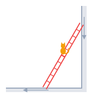

<!--
Copyright (c) 2026 Apurva Nakade. All rights reserved.
Released under Apache 2.0 license as described in the file LICENSE.
Authors: Apurva Nakade
-->


Memory works in weird ways. I was working on a project on [Gaussian Periods](https://www.gaussianperiods.com/) and we were discussing hypocycloids, which I hadn't thought about in a long time. Thinking about them brought back fond memories of a puzzle about a cat on a ladder, one that turns out to be secretly about them. 

## The puzzle

> A ladder leans against a wall, and a cat is sitting on its middle rung. The ladder starts to slide, its top down the wall and its foot along the floor, until it lies flat. What path does the cat trace as it rides the ladder down?

{width=200 fig-align="center" fig-alt="A ladder leaning against a wall with a cat sitting on its middle rung, and arrows showing the top sliding down the wall and the foot sliding along the floor."}

It took some creative googling to track down its source: *Straight Lines and Curves* by N. Vasilyev and V. Gutenmacher, published by [Mir](https://mirtitles.org/2013/10/21/straight-lines-and-curves-vasilyev-gutenmacher/).

Make a guess before reading on, then try the app, and click Path in the legend when you are ready to check.

```{ojs}
//| output: false
// VM is the shared utility library, loaded globally by the mathviz extension.
// This page uses VM.plotting.*, VM.ui.legendOverlay, VM.ui.statRow,
// VM.ui.urlParam and VM.ui.syncUrlParams.
vmTheme = Generators.observe(notify => VM.plotting.onThemeChange(notify))
chartColors = VM.plotting.colors(vmTheme)
```

```{ojs}
//| output: false
// A ladder of length catL leans against a wall (x = 0) on the floor (y = 0),
// in the second quadrant, so the cat moves right as it climbs, the same way
// its slider does. The top is at (0, L sin θ) and the foot at (−L cos θ, 0).
// A cat sitting a fraction t of the way up is at (−(1 − t) L cos θ, t L sin θ),
// so as θ runs from 90° down to 0° the cat traces a quarter of the ellipse
// x² / ((1 − t) L)² + y² / (t L)² = 1.
catL = 1
catDefaultT = 0.5
catDefaultSlide = 0.35

// The angle the ladder makes with the floor once it has slid a fraction s.
function catAngle(s) {
  return (Math.PI / 2) * (1 - s)
}

function catPosition(t, s) {
  const theta = catAngle(s)
  return {x: -(1 - t) * catL * Math.cos(theta), y: t * catL * Math.sin(theta)}
}

function clamp01(value) {
  return Math.min(1, Math.max(0, value))
}
```

```{ojs}
//| output: false
// Trace builders shared by all four charts. Every trace is a line (or
// marker) with no hover and no Plotly legend; the legend overlays replace it.
function scatter(props) {
  return {type: "scatter", mode: "lines", hoverinfo: "skip", showlegend: false, ...props}
}

// Wall and floor, with a little shading behind each.
function wallAndFloor() {
  const shade = VM.plotting.alpha("muted", 0.18)
  return [
    scatter({x: [0.06, 0, 0, 0.06, 0.06], y: [-0.04, -0.04, 1.15, 1.15, -0.04],
      fill: "toself", fillcolor: shade, line: {width: 0}}),
    scatter({x: [0.06, -1.15, -1.15, 0.06, 0.06], y: [-0.04, -0.04, 0, 0, -0.04],
      fill: "toself", fillcolor: shade, line: {width: 0}}),
    scatter({x: [0, 0, -1.15], y: [1.15, 0, 0], line: {color: chartColors.ink, width: 3}})
  ]
}

// The ladder at angle theta with the floor, from the wall to the floor.
function ladderTrace(theta) {
  return scatter({x: [0, -catL * Math.cos(theta)], y: [catL * Math.sin(theta), 0], mode: "lines+markers",
    line: {color: chartColors.alt, width: 5}, marker: {color: chartColors.alt, size: 9}})
}

function catMarker(point) {
  return scatter({x: [point.x], y: [point.y], mode: "markers+text", text: ["🐈"], textposition: "top center",
    textfont: {size: 26}, marker: {color: chartColors.warn, size: 12, line: {color: chartColors.halo, width: 2}}})
}

catLayout = ({
  xaxis: {range: [-1.15, 0.12], zeroline: false, showgrid: false, title: "x", constrain: "domain"},
  yaxis: {range: [-0.08, 1.15], zeroline: false, showgrid: false, title: "y", scaleanchor: "x", constrain: "domain"},
  showlegend: false,
  hovermode: false,
  uirevision: "static",
  margin: {t: 20},
  autosize: true
})

catPlot = VM.plotting.persistentPlot({height: "520px"})
```

<div class="vm-app" id="cat">

<div class="ojs-chart-block">

```{ojs}
catDraw = {
  const theta = catAngle(catSlide)
  const cat = catPosition(catT, catSlide)

  // The path so far, and the rest of it, faintly.
  const steps = 200
  const pastX = [], pastY = [], restX = [], restY = []
  for (let k = 0; k <= steps; k++) {
    const s = k / steps
    const p = catPosition(catT, s)
    if (s <= catSlide) {
      pastX.push(p.x)
      pastY.push(p.y)
    }
    if (s >= catSlide) {
      restX.push(p.x)
      restY.push(p.y)
    }
  }
  pastX.push(cat.x)
  pastY.push(cat.y)
  restX.unshift(cat.x)
  restY.unshift(cat.y)

  // The whole ellipse the arc belongs to; the ladder only ever sweeps the
  // quarter in the second quadrant.
  const a = (1 - catT) * catL
  const b = catT * catL
  const ellipseX = [], ellipseY = []
  for (let k = 0; k <= 400; k++) {
    const phi = 2 * Math.PI * k / 400
    ellipseX.push(a * Math.cos(phi))
    ellipseY.push(b * Math.sin(phi))
  }

  const data = wallAndFloor()
  if (catFull) {
    data.push(scatter({x: ellipseX, y: ellipseY, line: {color: chartColors.muted, width: 1.5, dash: "dash"}}))
  } else if (catShow) {
    // The full curve already covers the rest of the quarter.
    data.push(scatter({x: restX, y: restY, line: {color: VM.plotting.alpha("fn", 0.35), width: 1.5, dash: "dot"}}))
  }
  if (catShow) {
    data.push(scatter({x: pastX, y: pastY, line: {color: chartColors.fn, width: 3}}))
  }
  data.push(ladderTrace(theta))
  data.push(catMarker(cat))

  // With the full curve on, zoom out to one fixed view, as Full astroid
  // does in the envelope app: enough for the middle rung's whole circle
  // (radius L/2). It doesn't depend on Cat's height, so no slider rescales
  // the axes; longer ellipses run off the chart, there to zoom out to.
  let layout = catLayout
  if (catFull) {
    layout = {
      ...catLayout,
      xaxis: {...catLayout.xaxis, range: [-1.15, 0.65]},
      yaxis: {...catLayout.yaxis, range: [-0.65, 1.15]},
      uirevision: "full"
    }
  }
  return catPlot(data, layout)
}
```

```{ojs}
// The path is the puzzle, so it stays hidden until the reader asks for it.
viewof catTraces = {
  const value = []
  if (VM.ui.urlParam("cat_path", false)) value.push("Path")
  if (VM.ui.urlParam("cat_full", false)) value.push("Full curve")
  const items = [
    {label: "Path", color: chartColors.fn},
    {label: "Full curve", color: chartColors.muted}
  ]
  return VM.ui.legendOverlay(items, {value})
}
```

<div class="ojs-chart-controls ojs-grid">

```{ojs}
viewof catSlide = {
  const slider = Inputs.range([0, 1], {step: 0.005, value: clamp01(VM.ui.urlParam("cat_s", catDefaultSlide)), label: "Slide"})
  slider.classList.add("ojs-fill")
  return slider
}
```

```{ojs}
viewof catT = {
  const slider = Inputs.range([0, 1], {step: 0.01, value: clamp01(VM.ui.urlParam("cat_t", catDefaultT)), label: "Cat's height"})
  slider.classList.add("ojs-fill")
  return slider
}
```

</div>

</div>

```{ojs}
catStats = {
  const p = catPosition(catT, catSlide)
  const a = (1 - catT) * catL
  const b = catT * catL
  let shape = "ellipse"
  if (catT === 0 || catT === 1) {
    shape = "line segment"
  } else if (Math.abs(a - b) < 1e-9) {
    shape = "circle"
  }
  const stats = [
    {label: "Angle with floor", value: (catAngle(catSlide) * 180 / Math.PI).toFixed(1) + "°"},
    {label: "Cat at", value: `(${p.x.toFixed(3)}, ${p.y.toFixed(3)})`}
  ]
  if (catShow) {
    stats.push({label: "Path", value: shape})
    stats.push({label: "Semi-axes", value: `${a.toFixed(2)}, ${b.toFixed(2)}`, title: "x² / a² + y² / b² = 1"})
  }
  return VM.ui.statRow(stats)
}
```

</div>

```{ojs}
//| output: false
catShow = catTraces.includes("Path")
catFull = catTraces.includes("Full curve")

catUrlSync = VM.ui.syncUrlParams({cat_t: [catT, catDefaultT], cat_s: [catSlide, catDefaultSlide],
  cat_path: [catShow, false], cat_full: [catFull, false]})
```

On the middle rung, the cat traces a quarter circle of radius $L/2$ centered at the corner where the wall meets the floor, where $L$ is the length of the ladder. Anywhere else on the ladder, the path is a quarter of an ellipse; click Full curve in the legend to see the whole ellipse.

::: {.callout-tip title="Exercise"}
Why do you get a circle when the cat is at the midpoint of the ladder? There's a simple geometric proof of this. All you need to show is that the distance of the cat from the corner where the wall meets the floor does not change. Try to prove it yourself.
:::

### Circles inside circles

There's a more fun proof that the middle rung traces a circle, using rolling circles. Roll a circle of radius $L/2$ inside a circle of radius $L$. This pair is called the [Tusi couple](https://en.wikipedia.org/wiki/Tusi_couple), and it has a surprising property: every point on the small circle moves back and forth along a straight line, a diameter of the big circle ([try it in Spirographs](../spirographs/index.html?R=2&r=1&max=30&d=1&mode=inside&t=1)). It follows that if you track two diametrically opposite points on the smaller circle, they'll trace the wall and the floor, and the diameter connecting them will be the ladder.

Now it is easy to see that when the cat is sitting at the midpoint of the ladder, it is tracking the center of the smaller circle, which goes around in a circle of radius $L/2$.

```{ojs}
//| output: false
// The Tusi couple: a circle of radius L/2 rolls inside one of radius L. When
// its centre is at (L/2)(−cos θ, sin θ), its points (−L cos θ, 0) and
// (0, L sin θ) lie on the axes, and stay there as it rolls, so the diameter
// joining them is the ladder, now free to slide through all four quadrants.
tusiDefaultT = 0.5
// The first app's default slide, a quarter of the way into the second
// quadrant's fall: the two apps open with the ladder at the same angle.
// Rounded to the Roll slider's 0.001 step, or the slider would report a
// different value and an untouched page would get tusi_roll in its URL.
tusiDefaultRoll = Math.round(catDefaultSlide / 4 * 1000) / 1000
tusiView = 1.15
tusiPlot = VM.plotting.persistentPlot({height: "520px"})
tusiLayout = ({
  ...catLayout,
  xaxis: {...catLayout.xaxis, range: [-tusiView, tusiView]},
  yaxis: {...catLayout.yaxis, range: [-tusiView, tusiView]}
})

function tusiCircle(cx, cy, r, n = 200) {
  const xs = [], ys = []
  for (let k = 0; k <= n; k++) {
    const phi = 2 * Math.PI * k / n
    xs.push(cx + r * Math.cos(phi))
    ys.push(cy + r * Math.sin(phi))
  }
  return {xs, ys}
}

// The ladder's angle θ with the floor after a roll r (0 to 1, one full turn).
// Roll 0 stands the ladder upright, as Slide 0 does, and θ decreases as the
// roll grows, so the ladder falls the same way as in the first app and the
// small circle rolls counterclockwise.
function rollAngle(r) {
  return Math.PI / 2 - 2 * Math.PI * r
}

// Inputs.range for a roll from 0 to 1, one full turn of the small circle.
// mathviz gives it a play button, whose loop mode keeps the circles rolling.
function rollInput(value) {
  const slider = Inputs.range([0, 1], {step: 0.001, value, label: "Roll"})
  slider.classList.add("ojs-fill")
  return slider
}

// The parts both rolling-circle apps share: the two tracks (the floor and the
// wall extended right through), the big circle, the small circle and the
// point where it touches the big one. The ladder goes on top, separately.
function tusiFrame(theta) {
  const c = Math.cos(theta)
  const s = Math.sin(theta)
  const big = tusiCircle(0, 0, catL)
  const small = tusiCircle(-catL * c / 2, catL * s / 2, catL / 2)
  return [
    scatter({x: [-catL, catL, null, 0, 0], y: [0, 0, null, -catL, catL],
      line: {color: chartColors.muted, width: 1.5, dash: "dash"}}),
    scatter({x: big.xs, y: big.ys, line: {color: chartColors.ink, width: 2.5}}),
    scatter({x: small.xs, y: small.ys, fill: "toself", fillcolor: VM.plotting.alpha("alt", 0.1),
      line: {color: chartColors.alt, width: 2}}),
    scatter({x: [-catL * c], y: [catL * s], mode: "markers", marker: {color: chartColors.ink, size: 7}})
  ]
}
```

<div class="vm-app" id="tusi-couple">

<div class="ojs-chart-block">

```{ojs}
tusiDraw = {
  const theta = rollAngle(tusiRoll)
  const cat = {x: -(1 - tusiT) * catL * Math.cos(theta), y: tusiT * catL * Math.sin(theta)}

  // The cat's whole path, solid up to where it is now.
  const pastX = [], pastY = [], fullX = [], fullY = []
  for (let k = 0; k <= 400; k++) {
    const r = k / 400
    const phi = rollAngle(r)
    const x = -(1 - tusiT) * catL * Math.cos(phi)
    const y = tusiT * catL * Math.sin(phi)
    fullX.push(x)
    fullY.push(y)
    if (r <= tusiRoll) {
      pastX.push(x)
      pastY.push(y)
    }
  }
  pastX.push(cat.x)
  pastY.push(cat.y)

  const data = tusiFrame(theta)
  data.push(scatter({x: fullX, y: fullY, line: {color: VM.plotting.alpha("warn", 0.35), width: 1.5, dash: "dot"}}))
  data.push(scatter({x: pastX, y: pastY, line: {color: chartColors.warn, width: 3}}))
  data.push(ladderTrace(theta))
  data.push(catMarker(cat))
  return tusiPlot(data, tusiLayout)
}
```

<div class="ojs-chart-controls ojs-grid">

```{ojs}
viewof tusiRoll = rollInput(clamp01(VM.ui.urlParam("tusi_roll", tusiDefaultRoll)))
```

```{ojs}
viewof tusiT = {
  const slider = Inputs.range([0, 1], {step: 0.01, value: clamp01(VM.ui.urlParam("tusi_t", tusiDefaultT)), label: "Cat's height"})
  slider.classList.add("ojs-fill")
  return slider
}
```

</div>

</div>

</div>

```{ojs}
//| output: false
tusiUrlSync = VM.ui.syncUrlParams({tusi_roll: [tusiRoll, tusiDefaultRoll], tusi_t: [tusiT, tusiDefaultT]})
```

::: {.callout-tip title="Exercise"}
Why do you think changing the height of the cat changes the circle to an ellipse? Can you prove this using a simple geometric argument? Using rolling circles?
:::

## Enter hypocycloids

What does this have to do with [hypocycloids](../spirographs/index.html?R=4&r=1&max=30&d=1&mode=inside&t=1)? Forget the cat for a moment and watch the whole ladder. As it slides, it leaves a trail of its earlier positions behind. Those lines outline a curve that every position of the ladder just touches, called the envelope of the ladder. Click Envelope in the legend to see it: the curve is an astroid!

```{ojs}
//| output: false
// The envelope of the sliding ladder is the astroid x^(2/3) + y^(2/3) = L^(2/3),
// here its second-quadrant arc (−L cos³ θ, L sin³ θ). The ladder at angle θ
// touches it at the point a fraction sin² θ of the way up the ladder.
// How many earlier positions of the ladder are drawn over the whole slide.
envCount = 60
envView = 1.15
envDefaultSlide = 0
envPlot = VM.plotting.persistentPlot({height: "520px"})

function envTouch(s) {
  const theta = catAngle(s)
  return {x: -catL * Math.cos(theta) ** 3, y: catL * Math.sin(theta) ** 3}
}
```

<div class="vm-app" id="envelope">

<div class="ojs-chart-block">

```{ojs}
envDraw = {
  // Earlier positions of the ladder, evenly spaced over the whole slide; a
  // position appears once the ladder has slid past it. Drawn as one trace,
  // with a break (null) between segments.
  const ghostX = [], ghostY = []
  for (let k = 0; k < envCount; k++) {
    const s = k / (envCount - 1)
    if (s > envSlide) break
    const theta = catAngle(s)
    ghostX.push(0, -catL * Math.cos(theta), null)
    ghostY.push(catL * Math.sin(theta), 0, null)
  }

  const touch = envTouch(envSlide)

  const astroidX = [], astroidY = []
  for (let k = 0; k <= 300; k++) {
    const p = envTouch(k / 300)
    astroidX.push(p.x)
    astroidY.push(p.y)
  }

  // The whole astroid, all four arcs, of which the ladder only sweeps one.
  const fullX = [], fullY = []
  for (let k = 0; k <= 800; k++) {
    const phi = 2 * Math.PI * k / 800
    fullX.push(catL * Math.cos(phi) ** 3)
    fullY.push(catL * Math.sin(phi) ** 3)
  }

  const data = wallAndFloor()
  if (envFull) {
    data.push(scatter({x: fullX, y: fullY, line: {color: chartColors.muted, width: 1.5, dash: "dash"}}))
  }
  data.push(scatter({x: ghostX, y: ghostY, line: {color: VM.plotting.alpha("alt", 0.4), width: 1.5}}))
  if (envShow) {
    data.push(scatter({x: astroidX, y: astroidY, line: {color: chartColors.fn, width: 3}}))
  }
  data.push(ladderTrace(catAngle(envSlide)))
  if (envShow) {
    data.push(scatter({x: [touch.x], y: [touch.y], mode: "markers",
      marker: {color: chartColors.warn, size: 11, line: {color: chartColors.halo, width: 2}}}))
  }

  // With the full astroid on, widen the axes to fit all four arcs.
  let layout = catLayout
  if (envFull) {
    layout = {
      ...catLayout,
      xaxis: {...catLayout.xaxis, range: [-envView, envView]},
      yaxis: {...catLayout.yaxis, range: [-envView, envView]},
      uirevision: "full"
    }
  }
  return envPlot(data, layout)
}
```

```{ojs}
viewof envTraces = {
  const value = []
  if (VM.ui.urlParam("env_show", false)) value.push("Envelope")
  if (VM.ui.urlParam("env_full", false)) value.push("Full astroid")
  const items = [
    {label: "Envelope", color: chartColors.fn},
    {label: "Full astroid", color: chartColors.muted}
  ]
  return VM.ui.legendOverlay(items, {value})
}
```

<div class="ojs-chart-controls">

```{ojs}
viewof envSlide = {
  const slider = Inputs.range([0, 1], {step: 0.005, value: clamp01(VM.ui.urlParam("env_s", envDefaultSlide)), label: "Slide"})
  slider.classList.add("ojs-fill")
  return slider
}
```

</div>

</div>

</div>

```{ojs}
//| output: false
envShow = envTraces.includes("Envelope")
envFull = envTraces.includes("Full astroid")

envUrlSync = VM.ui.syncUrlParams({env_s: [envSlide, envDefaultSlide],
  env_show: [envShow, false], env_full: [envFull, false]})
```

What makes this remarkable is that an astroid is a hypocycloid: the curve traced by a point on a circle rolling inside another circle with four times its radius. So as the ladder slides, it is always tangent to the path of a point on a rolling circle.

### Circles inside circles inside circles

Rolling circles explain the envelope as well. Add a third circle, of radius $L/4$, rolling inside the big circle along with the other two. It fits snugly inside the small one: both touch the big circle at the same point, and its diameter runs from that point to the middle of the ladder. A point on this little circle traces the astroid, and that point always lies on the ladder.

```{ojs}
//| output: false
// A circle of radius L/4 rolling inside the big circle traces the astroid. It
// touches the big circle at the same point K = L(−cos θ, sin θ) as the Tusi
// circle, its diameter runs from K to the Tusi circle's centre, and its
// tracing point (−L cos³ θ, L sin³ θ) lies on the ladder, where the ladder
// touches the astroid.
astroDefaultRoll = tusiDefaultRoll
astroPlot = VM.plotting.persistentPlot({height: "520px"})
```

<div class="vm-app" id="astroid">

<div class="ojs-chart-block">

```{ojs}
astroDraw = {
  const theta = rollAngle(astroRoll)
  const c = Math.cos(theta)
  const s = Math.sin(theta)
  const quarter = {x: -3 * catL * c / 4, y: 3 * catL * s / 4}
  const tiny = tusiCircle(quarter.x, quarter.y, catL / 4)
  const trace = {x: -catL * c ** 3, y: catL * s ** 3}

  // Earlier positions of the ladder, one break (null) between each.
  const ghostX = [], ghostY = []
  if (astroTrail) {
    for (let k = 0; k < 4 * envCount; k++) {
      const r = k / (4 * envCount)
      if (r > astroRoll) break
      const phi = rollAngle(r)
      ghostX.push(0, -catL * Math.cos(phi), null)
      ghostY.push(catL * Math.sin(phi), 0, null)
    }
  }

  // The astroid, solid as far as the little circle has drawn it.
  const drawnX = [], drawnY = [], allX = [], allY = []
  for (let k = 0; k <= 800; k++) {
    const r = k / 800
    const phi = rollAngle(r)
    const x = -catL * Math.cos(phi) ** 3
    const y = catL * Math.sin(phi) ** 3
    allX.push(x)
    allY.push(y)
    if (r <= astroRoll) {
      drawnX.push(x)
      drawnY.push(y)
    }
  }
  drawnX.push(trace.x)
  drawnY.push(trace.y)

  const data = tusiFrame(theta)
  data.push(scatter({x: ghostX, y: ghostY, line: {color: VM.plotting.alpha("alt", 0.3), width: 1}}))
  data.push(scatter({x: allX, y: allY, line: {color: VM.plotting.alpha("fn", 0.3), width: 1.5, dash: "dot"}}))
  data.push(scatter({x: drawnX, y: drawnY, line: {color: chartColors.fn, width: 3}}))
  data.push(scatter({x: tiny.xs, y: tiny.ys, fill: "toself", fillcolor: VM.plotting.alpha("fn", 0.15),
    line: {color: chartColors.fn, width: 2}}))
  // A spoke to the tracing point, so the little circle visibly turns.
  data.push(scatter({x: [quarter.x, trace.x], y: [quarter.y, trace.y], line: {color: chartColors.fn, width: 1.5}}))
  data.push(ladderTrace(theta))
  data.push(scatter({x: [trace.x], y: [trace.y], mode: "markers",
    marker: {color: chartColors.fn, size: 12, line: {color: chartColors.halo, width: 2}}}))
  return astroPlot(data, tusiLayout)
}
```

```{ojs}
viewof astroTraces = {
  const value = []
  if (VM.ui.urlParam("astro_trail", true)) value.push("Ladder trail")
  return VM.ui.legendOverlay([{label: "Ladder trail", color: chartColors.alt}], {value})
}
```

<div class="ojs-chart-controls">

```{ojs}
viewof astroRoll = rollInput(clamp01(VM.ui.urlParam("astro_roll", astroDefaultRoll)))
```

</div>

</div>

</div>

```{ojs}
//| output: false
astroTrail = astroTraces.includes("Ladder trail")

astroUrlSync = VM.ui.syncUrlParams({astro_roll: [astroRoll, astroDefaultRoll], astro_trail: [astroTrail, true]})
```

::: {.callout-tip title="Exercise"}
Can you prove that the point on the little circle always lies on the ladder, exactly where the ladder touches the astroid?
:::

## References

N. Vasilyev and V. Gutenmacher, *Straight Lines and Curves*, Mir Publishers, 1980. [mirtitles.org](https://mirtitles.org/2013/10/21/straight-lines-and-curves-vasilyev-gutenmacher/)
