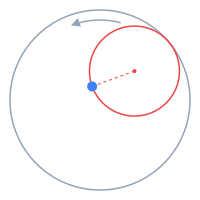

<!--
Copyright (c) 2026 Apurva Nakade. All rights reserved.
Released under Apache 2.0 license as described in the file LICENSE.
Authors: Apurva Nakade
-->

Suppose you roll a circle of radius 1 around the inside of a circle of radius 2, and follow a single point on the smaller circle. What path does that point trace? Think of an answer before looking below. You might be surprised.

{width=200 fig-align="center" fig-alt="A circle of radius 1 rolling inside a circle of radius 2, with one point on the small circle marked and an arrow showing the direction of rolling."}


```{ojs}
//| output: false
// VM is the shared utility library, loaded globally by the mathviz extension. This page uses VM.expressions.makeNumber, VM.plotting.*, VM.ui.legendOverlay, VM.ui.applyExampleParams.
VM = window.VM
```

```{ojs}
//| output: false
// Always-live controls (max, d, mode, t) read their initial value from the
// URL here; the commit-gated R/r fields read theirs inline below.
urlParams = new URLSearchParams(window.location.search)

initialMax = urlParams.get("max") ?? "30"

initialD = {
  const value = VM.expressions.makeNumber(window.math, urlParams.get("d") ?? "5")
  if (value === null || !Number.isFinite(value) || value < 0) return 5
  return value
}

initialMode = {
  if (urlParams.get("mode") === "outside") return "outside"
  return "inside"
}

initialTurns = {
  const value = Number(urlParams.get("t"))
  if (urlParams.get("t") === null || !Number.isFinite(value)) return null
  return value
}
```

```{ojs}
//| output: false
traceOptions = ["Fixed circle", "Rolling circle", "Traced path"]

// vmTheme re-runs everything that bakes a theme color into a trace; see
// apps/newton-method/index.qmd for the full explanation.
vmTheme = Generators.observe(notify => VM.plotting.onThemeChange(notify))

chartColors = VM.plotting.colors(vmTheme)

traceColors = new Map([
  ["Fixed circle", chartColors.muted],
  ["Rolling circle", chartColors.alt],
  ["Traced path", chartColors.fn]
])
```

```{ojs}
//| output: false
// examples backs the "Try an example" dropdown. max is listed first: it
// bounds the t slider, whose view is recreated when it changes.
examples = [
  // Classic named curves, one per (R, r, mode): a case that differs from
  // another only in d (the ellipse, the limaçon) is a drag of the d slider
  // away, so it is only in the menagerie at the bottom of the page.
  {
    title: "R = 2r: straight line (d = r) → ellipse",
    params: {max: "30", R: "2", r: "1", d: "1", mode: "inside"}
  },
  {
    title: "Hypocycloid: astroid (R = 4r, d = r)",
    params: {max: "30", R: "4", r: "1", d: "1", mode: "inside"}
  },
  {
    title: "R = r outside: cardioid (d = r) → limaçon",
    params: {max: "30", R: "1", r: "1", d: "1", mode: "outside"}
  },
  {
    title: "Rose (d = R − r)",
    params: {max: "30", R: "8", r: "3", d: "5", mode: "inside"}
  },
  // Beyond the named curves: rational and irrational ratios. The first is
  // the page's default inputs, so the dropdown names it on load.
  {
    title: "Rational ratio: R/r = 8/5, d = r",
    params: {max: "30", R: "8", r: "5", d: "5", mode: "inside"}
  },
  {
    title: "Rational ratio: five-point star (R/r = 5/3)",
    params: {max: "30", R: "5", r: "3", d: "5", mode: "inside"}
  },
  {
    title: "Rational ratio: rounded triangle (R/r = 3/2)",
    params: {max: "30", R: "3", r: "2", d: "1.5", mode: "inside"}
  },
  {
    title: "Rational ratio: lacy ring (R/r = 35/12)",
    params: {max: "30", R: "105", r: "36", d: "30", mode: "inside"}
  },
  {
    title: "Irrational ratio: R/r = √2, never closes",
    params: {max: "40", R: "sqrt(2)", r: "1", d: "0.8", mode: "inside"}
  },
  {
    title: "Irrational ratio: golden ratio, outside",
    params: {max: "30", R: "(1 + sqrt(5))/2", r: "1", d: "1.4", mode: "outside"}
  }
]
```

<div class="vm-app">

<div class="ojs-panel">

<div class="ojs-row">

<div class="ojs-grid">

```{ojs}
viewof RText = {
  const input = Inputs.text({label: "Fixed radius R", value: urlParams.get("R") ?? "8", placeholder: "Example: 5, sqrt(2)"})
  input.dataset.exampleField = "R"
  return input
}
```

```{ojs}
viewof rText = {
  const input = Inputs.text({label: "Rolling radius r", value: urlParams.get("r") ?? "5", placeholder: "Example: 3, pi/2"})
  input.dataset.exampleField = "r"
  return input
}
```

```{ojs}
// Always-live (not gated behind Plot): it bounds the t slider for a curve
// that never closes, or closes only after more turns than this.
viewof maxTurnsInput = {
  const input = Inputs.text({label: "Max turns", value: initialMax, placeholder: "Example: 30"})
  input.dataset.exampleField = "max"
  return input
}
```

```{ojs}
viewof mode = {
  const radio = Inputs.radio(new Map([["Inside", "inside"], ["Outside", "outside"]]), {label: "Rolls", value: initialMode})
  radio.dataset.exampleField = "mode"
  return radio
}
```

```{ojs}
viewof exampleSelect = {
  const options = [null, ...examples]
  const select = Inputs.select(options, {label: "Try an example", format: e => e ? e.title : "Custom inputs", value: null})
  select.classList.add("ojs-fill")
  return select
}
```

</div>

```{ojs}
// Plot commits R and r. The inside/outside toggle and the d and t sliders
// on the chart stay live.
viewof plotTrigger = {
  const plotButton = Inputs.button("Plot", {value: 0, reduce: v => v + 1})
  plotButton.classList.add("ojs-auto")
  return plotButton
}
```

</div>

```{ojs}
//| output: false
// Plain CSS selectors, not direct viewof references -- see
// mathviz's src/js/ui/apply-example.js.
exampleFieldSelectors = ({
  max: '[data-example-field="max"]',
  R: '[data-example-field="R"]',
  r: '[data-example-field="r"]',
  d: '[data-example-field="d"]',
  mode: '[data-example-field="mode"]'
})
```

```{ojs}
//| output: false
// A plain "change" listener attached once, not a cell reactive on
// exampleSelect -- see apps/newton-method/index.qmd.
applyExampleFromSelect = {
  const nativeSelect = (viewof exampleSelect).querySelector("select")
  if (!nativeSelect) return
  nativeSelect.addEventListener("change", () => {
    const example = (viewof exampleSelect).value
    if (!example) return
    VM.ui.applyExampleParams(exampleFieldSelectors, example.params, viewof plotTrigger)
  })
}
```

```{ojs}
//| output: false
// Keeps the dropdown naming the example the fields above hold ("Custom
// inputs" once none does). Reads every example field's value so it re-runs
// whenever one changes; it only sets the dropdown, never a field.
syncExampleFromFields = {
  maxTurnsInput; RText; rText; penDistance; mode
  VM.ui.syncExampleSelect(viewof exampleSelect, examples, exampleFieldSelectors)
}
```

</div>

```{ojs}
//| output: false
// Pressing Enter in R or r clicks Plot.
enterToPlot = {
  for (const view of [viewof RText, viewof rText]) {
    const input = view.querySelector("input")
    if (!input) continue
    input.addEventListener("keydown", (e) => {
      if (e.key !== "Enter") return
      e.preventDefault()
      viewof plotTrigger.querySelector("button").click()
    })
  }
}
```

```{ojs}
//| output: false
// committed snapshots R/r only when Plot is clicked (it reads the stable
// views, not the reactive values) and writes them into the URL.
committed = {
  plotTrigger
  const RVal = (viewof RText).value
  const rVal = (viewof rText).value

  const params = new URLSearchParams(window.location.search)
  params.set("R", RVal)
  params.set("r", rVal)
  history.replaceState(null, "", `${window.location.pathname}?${params}`)

  return {RText: RVal, rText: rVal}
}
```

```{ojs}
//| output: false
// max, d, mode and t are always-live, so they get their own sync cell.
urlSyncControls = {
  const params = new URLSearchParams(window.location.search)
  params.set("max", maxTurnsInput)
  params.set("d", String(penDistance))
  params.set("mode", mode)
  params.set("t", String(turns))
  history.replaceState(null, "", `${window.location.pathname}?${params}`)
  return true
}
```

```{ojs}
//| output: false
showFixed = traces.includes("Fixed circle")
```

```{ojs}
//| output: false
showRolling = traces.includes("Rolling circle")
```

```{ojs}
//| output: false
showPath = traces.includes("Traced path")
```

```{ojs}
//| output: false
maxTurns = {
  const parsed = VM.expressions.makeNumber(window.math, maxTurnsInput)
  if (parsed === null || !Number.isFinite(parsed) || parsed <= 0) return 30
  return Math.min(200, parsed)
}
```

```{ojs}
//| output: false
// rationalApprox finds p/q = x with q <= maxDen, via the continued-fraction
// convergents of x, or returns null when none is within a relative 1e-9.
// Floating-point input such as sqrt(2) or pi therefore reads as irrational:
// its closest convergents with q <= 1000 are still ~1e-7 off.
function rationalApprox(x, maxDen = 1000) {
  const tolerance = 1e-9 * Math.max(1, Math.abs(x))
  let pPrev = 1, qPrev = 0
  let p = Math.floor(x), q = 1
  let rest = x - Math.floor(x)
  while (q <= maxDen) {
    if (Math.abs(x - p / q) <= tolerance) return {p, q}
    if (rest < 1e-15) return null
    const inverse = 1 / rest
    const digit = Math.floor(inverse)
    rest = inverse - digit
    const pNext = digit * p + pPrev
    const qNext = digit * q + qPrev
    pPrev = p
    qPrev = q
    p = pNext
    q = qNext
  }
  return null
}
```

```{ojs}
//| output: false
// result: the committed radii, the live pen distance, whether R/r is rational, and
// closeTurns, the number of turns after which the curve closes (null: never).
// If R/r = p/q in lowest terms, the curve closes after q turns of the
// rolling circle's center around the fixed one, inside or outside alike.
// The exception is d = 0: the pen sits at the rolling circle's center, which
// traces the circle a e^{it} and closes after one turn whatever R/r is.
result = {
  const math = window.math
  const R = VM.expressions.makeNumber(math, committed.RText)
  const r = VM.expressions.makeNumber(math, committed.rText)
  const d = penDistance

  const valid = Number.isFinite(R) && Number.isFinite(r) && Number.isFinite(d) && R > 0 && r > 0
  if (!valid) return {valid: false, R: 1, r: 1, d: 0, fraction: null, closeTurns: null}

  const fraction = rationalApprox(R / r)
  let closeTurns = null
  if (d === 0) {
    closeTurns = 1
  } else if (fraction) {
    closeTurns = fraction.q
  }
  return {valid: true, R, r, d, fraction, closeTurns}
}
```

```{ojs}
//| output: false
// span: how many turns the t slider covers -- until the curve closes, or
// Max turns if it closes later or never.
span = {
  let closes = false
  let T = maxTurns
  if (result.closeTurns !== null && result.closeTurns <= maxTurns) {
    closes = true
    T = result.closeTurns
  }
  return {T, closes}
}
```

```{ojs}
//| output: false
// curve(R, r, d, mode) returns the geometry at angle theta (the angle of the
// rolling circle's center), with sigma = +1 inside and -1 outside:
//   a = R - sigma r          distance from the origin to the rolling center
//   k = a / r                how fast the rolling circle spins
//   z = a e^{i theta} + sigma d e^{-i sigma k theta}
function curve(R, r, d, mode) {
  let sigma = 1
  if (mode === "outside") sigma = -1
  const a = R - sigma * r
  const k = a / r
  return {
    a, k, sigma,
    center: theta => [a * Math.cos(theta), a * Math.sin(theta)],
    pen: theta => [
      a * Math.cos(theta) + sigma * d * Math.cos(k * theta),
      a * Math.sin(theta) - d * Math.sin(k * theta)
    ]
  }
}
```

```{ojs}
//| output: false
// path samples the whole curve over [0, T] turns once per commit/mode
// change, so moving the t slider only slices it. More samples per turn when
// the pen spins fast, capped so a long irrational run stays light.
path = {
  const {R, r, d} = result
  const geometry = curve(R, r, d, mode)
  const perTurn = 240 * (1 + Math.abs(geometry.k))
  const count = Math.max(200, Math.min(40000, Math.ceil(perTurn * span.T)))
  const xs = [], ys = []
  for (let i = 0; i <= count; i++) {
    const theta = 2 * Math.PI * span.T * i / count
    const [x, y] = geometry.pen(theta)
    xs.push(x)
    ys.push(y)
  }

  // Square view that holds the fixed circle, the rolling circle and the pen
  // at every d the slider can reach (up to 2r), not just the current d, so
  // dragging or playing the d slider never rescales the axes.
  const reach = Math.max(R, Math.abs(geometry.a) + r, Math.abs(geometry.a) + Math.max(2 * r, Math.abs(d)))
  const half = reach * 1.08

  return {xs, ys, count, geometry, half}
}
```

```{ojs}
//| output: false
// setup: the part of the path drawn up to the slider's t, and the rolling
// circle and pen arm at that t.
setup = {
  const {xs, ys, count, geometry, half} = path
  const theta = 2 * Math.PI * turns
  let cut = Math.floor(count * turns / span.T)
  if (cut > count) cut = count
  if (cut < 0) cut = 0
  const pathXs = xs.slice(0, cut + 1)
  const pathYs = ys.slice(0, cut + 1)
  const pen = geometry.pen(theta)
  pathXs.push(pen[0])
  pathYs.push(pen[1])

  const circle = (cx, cy, radius) => {
    const cxs = [], cys = []
    for (let i = 0; i <= 200; i++) {
      const phi = 2 * Math.PI * i / 200
      cxs.push(cx + radius * Math.cos(phi))
      cys.push(cy + radius * Math.sin(phi))
    }
    return {x: cxs, y: cys}
  }
  const center = geometry.center(theta)

  return {
    pathXs, pathYs, pen, center,
    fixedCircle: circle(0, 0, result.R),
    rollingCircle: circle(center[0], center[1], result.r),
    half,
    valid: result.valid,
    // Nothing here depends on d, so dragging or playing the d slider keeps
    // the zoom: maxTurns rather than span.T, which changes at d = 0 (where
    // the curve closes after one turn). Built here rather than inside
    // mainPlot's closure: naming committed or span there would make the
    // mainPlot cell itself re-run when they change, throwing away the reused
    // div and redrawing it detached, at Plotly's 700x450 default size.
    uirevision: `${committed.RText}|${committed.rText}|${mode}|${maxTurns}`
  }
}
```

```{ojs}
//| output: false
// mainPlot draws the fixed circle, the rolling circle with its pen arm, and
// the path traced so far. _plotDiv is reused across updates (Plotly.react),
// and uirevision is keyed on the curve, so zoom survives scrubbing t but
// resets for a new curve.
mainPlot = {
  const Plotly = window.Plotly
  let _plotDiv = null

  return ({pathXs, pathYs, pen, center, fixedCircle, rollingCircle, half, valid, uirevision}, showFixed, showRolling, showPath) => {
    const data = []

    if (valid && showFixed) {
      data.push({
        x: fixedCircle.x, y: fixedCircle.y, type: "scatter", mode: "lines", name: "Fixed circle", showlegend: false,
        line: {color: chartColors.muted, width: 2}, hoverinfo: "skip"
      })
    }

    if (valid && showPath) {
      data.push({
        x: pathXs, y: pathYs, type: "scatter", mode: "lines", name: "Traced path", showlegend: false,
        line: {color: chartColors.fn, width: 2},
        hovertemplate: "<b>Traced path</b><br>x = %{x:.4g}<br>y = %{y:.4g}<extra></extra>"
      })
    }

    if (valid && showRolling) {
      data.push({
        x: rollingCircle.x, y: rollingCircle.y, type: "scatter", mode: "lines", name: "Rolling circle", showlegend: false,
        line: {color: chartColors.alt, width: 2}, hoverinfo: "skip"
      })
      data.push({
        x: [center[0], pen[0]], y: [center[1], pen[1]], type: "scatter", mode: "lines+markers", name: "Pen arm", showlegend: false,
        line: {color: chartColors.alt, width: 1.5},
        marker: {color: chartColors.alt, size: [6, 0]}, hoverinfo: "skip"
      })
    }

    if (valid && (showPath || showRolling)) {
      data.push({
        x: [pen[0]], y: [pen[1]], type: "scatter", mode: "markers", name: "Pen", showlegend: false,
        marker: {color: chartColors.fn, size: 10, line: {color: chartColors.halo, width: 1.5}},
        hovertemplate: "<b>Pen</b><br>x = %{x:.4g}<br>y = %{y:.4g}<extra></extra>"
      })
    }

    const layout = {
      xaxis: {range: [-half, half], zeroline: false},
      yaxis: {range: [-half, half], zeroline: false, scaleanchor: "x", scaleratio: 1},
      annotations: valid ? [] : VM.plotting.emptyState("Couldn't read the radii — R and r must be positive numbers."),
      hovermode: "closest",
      uirevision,
      autosize: true
    }
    const config = VM.plotting.config()

    // Same curve as the last draw: keep whatever range is on screen, so a
    // reader's zoom survives moving d or t. uirevision alone can't do this
    // here: scaleanchor writes its adjusted range back into the div's
    // layout, so [-half, half] always looks like a new range to Plotly and
    // would replace the zoom.
    if (_plotDiv && _plotDiv.layout && _plotDiv.layout.uirevision === uirevision) {
      layout.xaxis.range = _plotDiv.layout.xaxis.range.slice()
      layout.yaxis.range = _plotDiv.layout.yaxis.range.slice()
    }

    if (!_plotDiv) {
      _plotDiv = document.createElement("div")
      _plotDiv.className = "plotly-box-large"
      Plotly.newPlot(_plotDiv, data, layout, config)
      VM.plotting.autoResize(_plotDiv)
      // The first draw happens detached, at Plotly's 700x450 default, and
      // scaleanchor widens the y-range to keep x and y at the same scale in
      // that box; the resize to the real box then keeps the widened range.
      // So once the div is on the page, resize it and redraw with the
      // intended range, or the first slider move would visibly rescale.
      const div = _plotDiv
      const firstFit = new ResizeObserver(() => {
        if (!div.isConnected || div.getClientRects().length === 0) return
        firstFit.disconnect()
        Plotly.Plots.resize(div).then(() => Plotly.react(div, data, layout, config))
      })
      firstFit.observe(div)
    } else {
      Plotly.react(_plotDiv, data, layout, config)
    }
    return _plotDiv
  }
}
```

```{ojs}
//| output: false
// Remembers whether the t slider has consumed the URL's t yet: only its
// first build should, since a later rebuild (a new curve, a new Max turns)
// should start from the whole curve rather than a stale t.
sliderState = ({usedUrl: false})
```

```{ojs}
//| output: false
// dRange: the d slider runs from 0 to 2r, which covers every example (the
// loopiest, the limacon, has d = 1.6r). It follows the r field as typed, not
// the committed r, so that applying an example -- which sets r, then d, then
// clicks Plot -- finds the slider already wide enough for the example's d.
dRange = {
  let r = VM.expressions.makeNumber(window.math, rText)
  // Not result.r: result reads this slider, so that would be a cycle.
  if (r === null || !Number.isFinite(r) || r <= 0) r = VM.expressions.makeNumber(window.math, committed.rText)
  if (r === null || !Number.isFinite(r) || r <= 0) r = 1
  return 2 * r
}

// dState remembers the d slider's value across rebuilds (a new r gives it
// a new range), so a rebuild keeps d rather than resetting it.
dState = ({value: initialD})
```

```{ojs}
//| output: false
dRemember = { dState.value = penDistance }
```

<div class="ojs-chart-block">

```{ojs}
mainPlot(setup, showFixed, showRolling, showPath)
```

```{ojs}
viewof traces = {
  const items = []
  for (const label of traceOptions) items.push({label, color: traceColors.get(label)})
  return VM.ui.legendOverlay(items, {value: traceOptions})
}
```

<div class="ojs-chart-controls ojs-grid">

```{ojs}
viewof penDistance = {
  const value = Math.min(dRange, dState.value)
  const slider = Inputs.range([0, dRange], {step: 0.01, value, label: "Pen distance d"})
  slider.dataset.exampleField = "d"
  slider.classList.add("ojs-fill")
  return slider
}
```

```{ojs}
viewof turns = {
  let value = span.T
  if (!sliderState.usedUrl && initialTurns !== null) value = Math.min(span.T, Math.max(0, initialTurns))
  sliderState.usedUrl = true
  const slider = Inputs.range([0, span.T], {step: 0.005, value, label: "Turns t/2π"})
  slider.classList.add("ojs-fill")
  return slider
}
```

</div>

</div>

</div>

A circle of radius $r$ rolls without slipping inside (a *hypotrochoid*) or outside (an *epitrochoid*) a fixed circle of radius $R$, and a pen at distance $d$ from its center traces the curve. Let $t$ be the angle of the rolling circle's center, and put
$$
a = R \mp r, \qquad k = \frac{a}{r}, \qquad m = \frac{R}{r},
$$
with the upper sign for inside and the lower for outside throughout.

<style>
.spiro-equations td { vertical-align: middle; }
.spiro-menagerie {
  list-style: none;
  padding: 0;
  margin: 1rem 0;
  display: grid;
  grid-template-columns: repeat(auto-fill, minmax(128px, 1fr));
  gap: 0.75rem;
}
.spiro-menagerie a {
  display: flex;
  flex-direction: column;
  align-items: center;
  gap: 0.4rem;
  height: 100%;
  padding: 0.5rem;
  border: 1px solid var(--vm-border);
  border-radius: var(--vm-radius);
  background: var(--vm-surface);
  color: var(--vm-text);
  font-size: 0.85rem;
  line-height: 1.3;
  text-align: center;
  text-decoration: none;
}
.spiro-menagerie a:hover,
.spiro-menagerie a:focus-visible {
  border-color: var(--vm-accent);
  background: var(--vm-surface-hover);
}
.spiro-menagerie svg {
  width: 100%;
  height: auto;
  aspect-ratio: 1;
}
.spiro-menagerie path {
  fill: none;
  stroke: var(--vm-color-fn);
  stroke-width: 1.25;
  stroke-linejoin: round;
  vector-effect: non-scaling-stroke;
}
</style>

```{ojs}
// equationsTable: one row per form of the curve -- the general formula
// (upper sign inside, lower outside), then the same formula with the
// current R, r, d substituted.
equationsTable = {
  const general = {
    cartesian: tex`\begin{aligned} x(t) &= a\cos t \pm d\cos(kt) \\ y(t) &= a\sin t - d\sin(kt) \end{aligned}`,
    complex: tex`z(t) = a\,e^{it} \pm d\,e^{\mp ikt}`,
    polar: tex`\begin{aligned} \rho(t)^2 &= a^2 + d^2 \pm 2ad\cos(mt) \\ \theta(t) &= t - \operatorname{atan2}\big(d\sin(mt),\ a \pm d\cos(mt)\big) \end{aligned}`,
    closes: html`<span>After ${tex`t = 2\pi q`} if ${tex`R/r = p/q`} in lowest terms, with ${tex`p`}-fold symmetry; never if ${tex`R/r`} is irrational. After ${tex`t = 2\pi`} if ${tex`d = 0`}: the pen is at the rolling circle's center.</span>`
  }
  const current = {cartesian: null, complex: null, polar: null, closes: null}

  if (result.valid) {
    const {R, r, d, fraction} = result
    const {a, k, sigma} = path.geometry
    const number = x => {
      const text = String(Number(x.toPrecision(5)))
      return text.replace(/e\+?(-?\d+)/, "\\times 10^{$1}")
    }
    // |value| as a fraction numerator/denominator when R/r is rational, as
    // a decimal otherwise.
    const magnitude = (value, numerator, denominator) => {
      if (!fraction) return number(Math.abs(value))
      if (denominator === 1) return String(Math.abs(numerator))
      return `\\tfrac{${Math.abs(numerator)}}{${denominator}}`
    }
    // A leading coefficient, dropped when it is 1 (and just "-" for -1).
    const lead = coefficient => {
      if (coefficient === 1) return ""
      if (coefficient === -1) return "-"
      return number(coefficient)
    }
    // " + c·body" / " - c·body", folding c's own sign into the operator.
    const term = (coefficient, body) => {
      let sign = "+"
      if (coefficient < 0) sign = "-"
      return ` ${sign} ${lead(Math.abs(coefficient))}${body}`
    }
    // "k t", or just "t" when the rate is 1.
    const angle = rate => {
      if (rate === "1") return "t"
      return `${rate}\\,t`
    }

    // k's sign is pulled out of every trig call (cos is even, sin is odd),
    // so the formulas only ever show |k|.
    let kSign = 1
    if (k < 0) kSign = -1
    let kText = magnitude(k, 0, 1)
    let mText = magnitude(R / r, 0, 1)
    if (fraction) {
      kText = magnitude(k, fraction.p - sigma * fraction.q, fraction.q)
      mText = magnitude(R / r, fraction.p, fraction.q)
    }
    let expSign = ""
    if (-sigma * kSign < 0) expSign = "-"

    const x = `x(t) &= ${lead(a)}\\cos t${term(sigma * d, `\\cos(${angle(kText)})`)}`
    const y = `y(t) &= ${lead(a)}\\sin t${term(-d * kSign, `\\sin(${angle(kText)})`)}`
    const z = `z(t) = ${lead(a)}\\,e^{it}${term(sigma * d, `\\,e^{${expSign}i${angle(kText)}}`)}`
    const rho = `\\rho(t)^2 &= ${number(a * a + d * d)}${term(2 * sigma * a * d, `\\cos(${angle(mText)})`)}`
    const theta = `\\theta(t) &= t - \\operatorname{atan2}\\big(${lead(d)}\\sin(${angle(mText)}),\\ ${number(a)}${term(sigma * d, `\\cos(${angle(mText)})`)}\\big)`

    current.cartesian = tex`\begin{aligned} ${x} \\ ${y} \end{aligned}`
    current.complex = tex`${z}`
    current.polar = tex`\begin{aligned} ${rho} \\ ${theta} \end{aligned}`
    if (d === 0) {
      current.closes = html`<span>After ${tex`t = 2\pi`}: with ${tex`d = 0`} the pen is at the rolling circle's center, which traces a circle of radius ${tex`${number(Math.abs(a))}`}.</span>`
    } else if (fraction) {
      current.closes = html`<span>After ${tex`t = 2\pi \cdot ${fraction.q}`}, with ${fraction.p}-fold symmetry, since ${tex`R/r = ${mText}`}.</span>`
    } else {
      current.closes = html`<span>Never: ${tex`R/r \approx ${number(R / r)}`} is irrational.</span>`
    }
  }

  const rows = [["Cartesian", "cartesian"], ["Complex", "complex"], ["Polar", "polar"], ["Closes", "closes"]]
  const body = []
  for (const [label, key] of rows) {
    let currentCell = html`<td></td>`
    if (current[key]) currentCell = html`<td>${current[key]}</td>`
    body.push(html`<tr><th scope="row">${label}</th><td>${general[key]}</td>${currentCell}</tr>`)
  }
  return html`<table class="table spiro-equations">
    <thead><tr><th scope="col">Form</th><th scope="col">Equation</th><th scope="col">This curve</th></tr></thead>
    <tbody>${body}</tbody>
  </table>`
}
```

## A menagerie

```{ojs}
//| output: false
// menagerie: the curves in the grid below, each loaded into the app by its
// card. params are in the same order as an example's (max first: it bounds
// the t slider). caption overrides the parameter caption for a curve
// without a name whose radii aren't plain numbers.
menagerie = [
  {name: "Tusi couple", params: {max: "30", R: "2", r: "1", d: "1", mode: "inside"}},
  {name: "Ellipse", params: {max: "30", R: "2", r: "1", d: "0.5", mode: "inside"}},
  {name: "Deltoid", params: {max: "30", R: "3", r: "1", d: "1", mode: "inside"}},
  {name: "Astroid", params: {max: "30", R: "4", r: "1", d: "1", mode: "inside"}},
  {name: "Cardioid", params: {max: "30", R: "1", r: "1", d: "1", mode: "outside"}},
  {name: "Nephroid", params: {max: "30", R: "2", r: "1", d: "1", mode: "outside"}},
  {name: "Ranunculoid", params: {max: "30", R: "5", r: "1", d: "1", mode: "outside"}},
  {name: "Limaçon", params: {max: "30", R: "1", r: "1", d: "1.6", mode: "outside"}},
  {name: "Rose", params: {max: "30", R: "8", r: "3", d: "5", mode: "inside"}},
  {params: {max: "30", R: "8", r: "5", d: "5", mode: "inside"}},
  {params: {max: "30", R: "5", r: "3", d: "5", mode: "inside"}},
  {params: {max: "30", R: "3", r: "2", d: "1.5", mode: "inside"}},
  {params: {max: "30", R: "7", r: "4", d: "5", mode: "inside"}},
  {params: {max: "30", R: "11", r: "4", d: "6", mode: "inside"}},
  {params: {max: "30", R: "105", r: "36", d: "30", mode: "inside"}},
  {params: {max: "30", R: "5", r: "2", d: "3", mode: "outside"}},
  {params: {max: "30", R: "3", r: "1", d: "1.8", mode: "outside"}},
  {caption: "R = √2, r = 1, d = 0.8, inside", params: {max: "40", R: "sqrt(2)", r: "1", d: "0.8", mode: "inside"}},
  {caption: "R = φ, r = 1, d = 1.4, outside", params: {max: "30", R: "(1 + sqrt(5))/2", r: "1", d: "1.4", mode: "outside"}}
]
```

```{ojs}
// menagerieGrid: one card per curve, its whole path drawn until it closes
// (Max turns if it never does). Each card's href is the curve's own URL, so
// opening it in a new tab or copying it works; a plain click instead
// applies it in place, like the dropdown (no reload), and scrolls back up
// to the chart. The dropdown names it, if it is an example, by itself.
menagerieGrid = {
  const svgNS = "http://www.w3.org/2000/svg"
  const list = document.createElement("ul")
  list.className = "spiro-menagerie"

  for (const entry of menagerie) {
    const {params} = entry
    const R = VM.expressions.makeNumber(window.math, params.R)
    const r = VM.expressions.makeNumber(window.math, params.r)
    const d = VM.expressions.makeNumber(window.math, params.d)
    const geometry = curve(R, r, d, params.mode)

    // Turns until the curve closes, as in the result cell.
    let T = Number(params.max)
    const fraction = rationalApprox(R / r)
    if (d === 0) {
      T = 1
    } else if (fraction) {
      T = fraction.q
    }
    const perTurn = 240 * (1 + Math.abs(geometry.k))
    const count = Math.max(400, Math.min(6000, Math.ceil(perTurn * T)))

    // SVG's y axis points down, so y is negated to match the chart.
    let pathText = ""
    let reach = 0
    for (let i = 0; i <= count; i++) {
      const [x, y] = geometry.pen(2 * Math.PI * T * i / count)
      let command = "L"
      if (i === 0) command = "M"
      pathText += `${command}${x.toFixed(4)} ${(-y).toFixed(4)}`
      reach = Math.max(reach, Math.abs(x), Math.abs(y))
    }
    const half = reach * 1.06

    const svg = document.createElementNS(svgNS, "svg")
    svg.setAttribute("viewBox", `${-half} ${-half} ${2 * half} ${2 * half}`)
    svg.setAttribute("aria-hidden", "true")
    const path = document.createElementNS(svgNS, "path")
    path.setAttribute("d", pathText)
    svg.append(path)

    let parameters = `R = ${params.R}, r = ${params.r}, d = ${params.d}, ${params.mode}`
    if (entry.caption) parameters = entry.caption
    let caption = parameters
    if (entry.name) caption = entry.name

    const link = document.createElement("a")
    link.href = `${window.location.pathname}?${new URLSearchParams(params)}`
    link.title = parameters
    const label = document.createElement("span")
    label.textContent = caption
    link.append(svg, label)
    link.addEventListener("click", (e) => {
      if (e.metaKey || e.ctrlKey || e.shiftKey || e.button !== 0) return
      e.preventDefault()
      document.querySelector(".vm-app").scrollIntoView({behavior: "smooth"})
      VM.ui.applyExampleParams(exampleFieldSelectors, params, viewof plotTrigger)
    })

    const item = document.createElement("li")
    item.append(link)
    list.append(item)
  }
  return list
}
```
